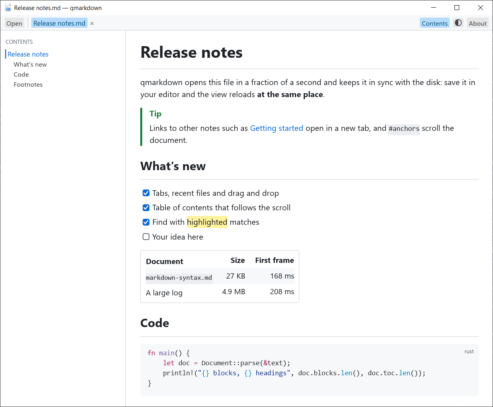

<p align="center">
  
</p>

<h1 align="center">MetalMD</h1>

<p align="center">A fast native Markdown viewer for Windows</p>

<p align="center">
  <a href="https://github.com/Fan4Metal/metalmd/releases/latest"></a>
  
  
  <a href="LICENSE"></a>
</p>

<p align="center"><b>English</b> | <a href="README.ru.md">Русский</a></p>

MetalMD is a Markdown viewer that shows a document about 0.2 s after you double-click it. It is a rewrite of the viewing half of [Markpad](https://github.com/sftwrdotdev/Markpad) in Rust. Markpad is built on Tauri and SvelteKit, so it starts WebView2 and loads a JavaScript bundle with Monaco, KaTeX and Mermaid. MetalMD draws the document itself with [egui](https://github.com/emilk/egui) and OpenGL, with no browser engine. It has no editor: the file is edited in any other editor, and MetalMD reloads the view each time it is saved. The only change MetalMD makes to a file is ticking a task list item.



*Screenshot of version 0.2.0.*

## Features

- **Fast**: the document appears about 0.2 s after start-up, for a 27 KB note as for a 5 MB log (see [Start-up speed](#start-up-speed)).
- **GitHub-flavoured Markdown**: tables, task lists, strikethrough, autolinks, footnotes, `> [!NOTE]` alerts and front matter, through [comrak](https://github.com/kivikakk/comrak).
- **Obsidian and Markpad syntax**: `[[Note#Heading|alias]]` wikilinks, `![[image.png|300x200]]` embeds, `^block-id` anchors, `==highlight==`, `++insert++`, `^[inline footnotes]` and definition lists. A single newline is a line break (see [Supported Markdown](#supported-markdown)).
- **Code highlighting** for about 200 languages, in colours that follow the light or dark theme.
- **Formulas**: `$…$` and `$$…$$` are typeset as KaTeX does it, by [RaTeX](https://github.com/erweixin/RaTeX), a port of KaTeX to Rust.
- **Colour emoji**, drawn with the system emoji font (Segoe UI Emoji).
- **Mermaid diagrams** in ```` ```mermaid ```` blocks (flowcharts, sequence, class, state, ER, pie, Gantt and others), drawn by [mermaid-svg](https://github.com/xmiksay/mermaid) in the light or dark Mermaid theme.
- **README-style HTML**: centred `<p align="center">` blocks, `` with a size, `<kbd>`, `<details>` that opens and closes with a click on its summary, and other tags common in READMEs.
- **Fonts and text size**: the Aa button opens a panel where the text font, the code font and the text size are chosen from the fonts installed in the system. Changes apply at once. Variable fonts get their bold and italic from their axes, and a family without italic is slanted.
- **Table of contents**: it highlights the current section, and a click jumps to a heading. It stands on the left or on the right: right-click its button or the panel to choose.
- **Tabs**: links to other `.md` files open in new tabs. Recent files are on the start page, and files can be dropped onto the window. A tab dragged out of the window gets a window of its own, a tab dragged into another window joins it, and dragging along the bar rearranges them.
- **Live reload**: a file changed on disk is reloaded at the same scroll position.
- **Task lists can be ticked**: a click on a box switches `- [ ]` and `- [x]` in the file itself. Only that character changes; the encoding and line endings stay as they were. `Ctrl+Z` undoes the ticks one by one, as long as the file has not been changed by another program since.
- **Find** in the document with `Ctrl+F`. Text can be selected across paragraphs and copied.
- **Light, dark or system theme**, and zoom.
- **English or Russian interface**: it follows the language of Windows and can be changed in the About window (`F1`).
- **Any encoding**: UTF-8, UTF-16 and legacy code pages (Windows-1251, GBK, Shift_JIS and others) are detected automatically.
- **One window**: a file opened while MetalMD is running goes to a new tab of the open window.
- **Portable**: the [portable archive](#installation) keeps its settings next to the program.

## Supported Markdown

| Syntax | Example |
|---|---|
| CommonMark | `**bold**`, `*italic*`, `` `code` ``, headings, lists, quotes, rules, links, images |
| GitHub extensions | tables, `- [x]` task lists, `~~strikethrough~~`, bare URLs, `[^1]` footnotes, `> [!NOTE]` alerts |
| Obsidian | `[[Note#Heading\|alias]]` wikilinks, `![[image.png\|300x200]]` embeds, `^block-id` anchors |
| Other extensions | `==highlight==`, `++insert++`, `^[inline footnote]`, definition lists, YAML front matter |
| Math | `$E = mc^2$` inline, `$$ … $$` on its own lines, LaTeX as [KaTeX](https://katex.org/docs/supported) supports it |
| Diagrams | ```` ```mermaid ```` blocks: the diagram types of [mermaid-svg](https://github.com/xmiksay/mermaid) |
| Code blocks | highlighted with [syntect](https://github.com/trishume/syntect) and the grammars of [two-face](https://github.com/CosmicHorrorDev/two-face) |
| Images | PNG, JPEG, GIF, WebP, SVG, BMP and ICO, local or over http(s); animated GIF, WebP and APNG play; SVG badges keep their text |
| HTML | ``, `<a>`, `<br>`, `<p align="center">`, `<b>`, `<i>`, `<kbd>`, `<sub>`, `<sup>`, `<mark>`, `<details>` |

**Not supported**:

- video, audio and YouTube previews: they are not shown;
- Markpad's extra alert types (`[!TODO]` and others), foldable alerts;
- `data:` images;
- HTML beyond the tags above;
- flag emoji in colour: Segoe UI Emoji has no flags, so 🇷🇺 shows as the letters RU, as in browsers on Windows.

## Installation

The installer and the portable archive are on the [Releases](https://github.com/Fan4Metal/metalmd/releases) page.

The installer, `MetalMD_<version>_Setup.exe`, needs no administrator rights. It puts the program in `%LOCALAPPDATA%\Programs\MetalMD`. The option "Register MetalMD for Markdown files" is on by default (see [File associations](#file-associations)). If it is on, the last page of the installer offers to open Windows Settings, where you can make MetalMD the default program. Uninstalling removes the registration.

The portable archive, `MetalMD_<version>_portable.zip`, holds the program in a `MetalMD` folder and runs without installation. It also holds an empty `metalmd.json`. While that file is next to `metalmd.exe` and the folder is writable, the settings and recent files are kept in it, so you can carry the program on a removable drive. Without the file, the program keeps them in `%APPDATA%\MetalMD\config\settings.json`, as the installed program does. The About window shows where the settings are kept.

## Keyboard shortcuts

| Keys | Action |
|---|---|
| `Ctrl+O` | Open a file |
| `Ctrl+W`, middle click on a tab | Close the tab |
| `Ctrl+Tab`, `Ctrl+Shift+Tab` (`Ctrl+PageDown`, `Ctrl+PageUp`) | Next and previous tab |
| `Ctrl+F` | Find |
| `Enter`, `F3` / `Shift+Enter`, `Shift+F3` | Next and previous match |
| `Esc` | Close find |
| `Ctrl+Shift+O` | Show or hide the table of contents |
| `F5`, `Ctrl+R` | Reload the file |
| `Ctrl+Z` | Undo the last tick of a task list item |
| `Alt+←`, mouse Back button | Go back after following a link |
| `Ctrl+=` / `Ctrl+−` / `Ctrl+0`, `Ctrl`+wheel | Zoom in, out, reset |
| `PageUp`, `PageDown`, `Space` / `Shift+Space`, arrows | Scroll |
| `Home`, `End` (`Ctrl+Home`, `Ctrl+End`) | Go to the start or the end |
| `F1` | About |

With the mouse: a code block shows a Copy button under the pointer, and the context menu of a `$$` formula or a diagram copies its source ("Copy TeX", "Copy Mermaid source"); the zoom shown next to the toolbar buttons resets it with a click; the contents button or panel chooses the side of the table of contents with a right click; a tab is moved along the bar, into another window or out into a new one by dragging its title, and its context menu does the same and also closes the other tabs.

## Usage

```
metalmd.exe [FILE...] [--new-instance]
```

Each file opens in a tab. If MetalMD is already running, it receives the files and comes to the foreground; `--new-instance` opens a separate window instead.

Links to other Markdown files (`.md`, `.markdown`, `.mdown`, `.mkd`, `.txt`) open in a new tab, at the heading or block named after `#`. `#anchor` links scroll the document. Other links open in the default program.

The theme, zoom, interface language, fonts and text size, the table of contents' visibility and side, window position and size, and the last nine files are saved between runs.

The program does not access the network, except to load images that a document links over http(s).

## File associations

The installer's "Register MetalMD for Markdown files" option registers `.md`, `.markdown`, `.mdown` and `.mkd` for the current user. MetalMD then appears in "Open with" and in Settings → Default apps. Windows lets only the user choose the default program. The installer offers to open Settings for that, or you can pick MetalMD the first time you open a Markdown file.

Without the installer, open the context menu of a `.md` file and choose "Open with" → "Choose another app" → `metalmd.exe` → "Always use this app".

## Start-up speed

The table shows the time from process creation to the frame that shows the document. It was measured on a release build on Windows 10 with an i7-12700K and an RTX 4070 Ti at 2560×1440, 125%, taking the median of 10 runs with a warm OS cache.

| Document | Document drawn | Next frame |
|---|---|---|
| `samples/markdown-syntax.md`, 27 KB | 168 ms | 219 ms |
| 4.9 MB of Markdown | 208 ms | 263 ms |

About 130 ms of this is the graphics driver creating the window and the OpenGL context. Reading and parsing run in parallel with that. Laying out the first screen adds 10–50 ms, even for files of several megabytes.

- The files on the command line are read and parsed on background threads right after the process starts, while the window is being created.
- The document is parsed once into a ready model of blocks. Each frame lays out only the visible blocks, and the heights of the others are measured gradually.
- Syntax highlighting, the file watcher and the Chinese, Japanese and Korean fonts load after the first frame, and only when needed.
- The renderer is OpenGL (glow). On the same machine, wgpu takes ~240 ms to create its context with DirectX 12 and ~290 ms with Vulkan, against ~130 ms for OpenGL.

To measure on your machine, run:

```
metalmd.exe --bench timings.json path\to\file.md
```

The program opens the file, writes timestamps in milliseconds since process creation, and exits.

## Building

You need Windows 10 or later, stable Rust 1.95 or newer with the MSVC toolchain, and Visual Studio 2022 Build Tools. To run `build.py`, you also need [uv](https://docs.astral.sh/uv/).

```
uv run build.py          # target\release\metalmd.exe
cargo test
```

`build.py` first closes any `metalmd.exe` running from the project's `target` folder, because it would lock the file. Then it runs `cargo build --release`, passing on any extra arguments to cargo. uv installs its only dependency, `psutil`. When MetalMD is not running, plain `cargo build --release` works as well. The executable links the C runtime statically (`.cargo/config.toml`), so it needs nothing beyond Windows itself.

<details>
<summary>Source layout</summary>

```
build.rs               draws the icon: .ico for the exe, RGBA for the window and the start page
build.py               release build that first closes a running exe
.github/workflows/
  release.yml          installer and portable zip on a vX.Y.Z tag
tools/
  make_release.py      tests, release build, installer and portable zip in dist\
  setup.iss            Inno Setup installer, .md associations
samples/               markdown-syntax.md, the dialect in one document (from Markpad)
images/                the icon and the screenshot of this README
src/
  icon.rs              the procedural icon (a page with the Markdown mark), shared with build.rs
  main.rs              arguments, hand-off to a running window, early loading, eframe, panic message
  app.rs               windows and tabs, messages from background threads, links, keys, panels
  bench.rs             --bench: start-up timestamps
  caption.rs           the window caption in the app's theme
  placement.rs         the restored window kept on a screen
  i18n.rs              English and Russian strings, tr!
  fs_text.rs           reading and encoding detection (from Markpad)
  settings.rs          settings, recent files, portable mode
  single_instance.rs   one process per user: named pipe / local socket
  watcher.rs           file watching (notify)
  style.rs             colours, fonts, text size, egui visuals
  fonts.rs             the system's font families, a chosen family resolved to its faces
  markdown/
    preprocess.rs      wikilinks, embeds, block ids, comrak options (from Markpad)
    document.rs        comrak AST → a block model with styled text
    html.rs            HTML tokenizer for the README subset
    emoji.rs           which characters are colour emoji (UTS #51)
    highlight.rs       code highlighting on a background thread
  ui/
    viewer.rs          virtualized document rendering
    render_cache.rs    pictures made from text on a worker thread
    math.rs            formulas: RaTeX, rasterized by resvg
    diagram.rs         Mermaid diagrams: mermaid-svg, rasterized by resvg
    emoji.rs           colour emoji from the system emoji font
    copy.rs            copying formulas and emoji as their source
    svg.rs             SVG images with text (README badges)
    animation.rs       animated GIF, WebP and APNG
    limit.rs           images larger than the GPU takes, made smaller
    toc.rs             table of contents
    text.rs            Text panel: fonts and text size
    find.rs            find bar
    home.rs            start page with the icon and recent files
    about.rs           About window
```

</details>

## Installer and release

The release script builds the executable, the installer and the portable archive. It needs [Inno Setup 6](https://jrsoftware.org/isinfo.php).

```
python tools/make_release.py              # tests, release build, installer, archive
python tools/make_release.py --no-tests   # the same without cargo test
python tools/make_release.py --install    # then a silent installation over the installed copy
```

The script writes the files to `dist` and takes the version from `Cargo.toml`. Like `build.py`, it first closes a `metalmd.exe` running from `target\release`. The installer script is `tools/setup.iss`. `metalmd.exe --export-icon <file.ico>` writes the installer icon.

The **Release** workflow (`.github/workflows/release.yml`) builds the releases on GitHub. Update the version in `Cargo.toml`, commit it, and push a matching tag. The workflow then publishes a release with the installer and the portable archive:

```
git tag v0.2.1
git push origin v0.2.1
```

Running the workflow manually (Actions → Release → Run workflow) builds the files and attaches them to the run, without making a release.

## Built with

MetalMD is built on these open-source projects:

- [Markpad](https://github.com/sftwrdotdev/Markpad): the Markdown dialect, preprocessing and encoding detection;
- [egui / eframe](https://github.com/emilk/egui): the user interface and the window;
- [comrak](https://github.com/kivikakk/comrak): Markdown parsing;
- [syntect](https://github.com/trishume/syntect) and [two-face](https://github.com/CosmicHorrorDev/two-face): code highlighting;
- [RaTeX](https://github.com/erweixin/RaTeX) and the [KaTeX](https://katex.org) fonts: formulas;
- [mermaid-svg](https://github.com/xmiksay/mermaid): Mermaid diagrams;
- [resvg](https://github.com/linebender/resvg): drawing formulas, diagrams, emoji and SVG images;
- [notify](https://github.com/notify-rs/notify): watching files for changes;
- [Inno Setup](https://jrsoftware.org/isinfo.php): the installer.

## License

MIT, see [LICENSE](LICENSE).

The code ported from Markpad (`src/markdown/preprocess.rs`, `src/fs_text.rs`) and `samples/markdown-syntax.md` are under the BSD 3-Clause License; see [THIRD_PARTY_LICENSES.md](THIRD_PARTY_LICENSES.md). That file ships with the program.
